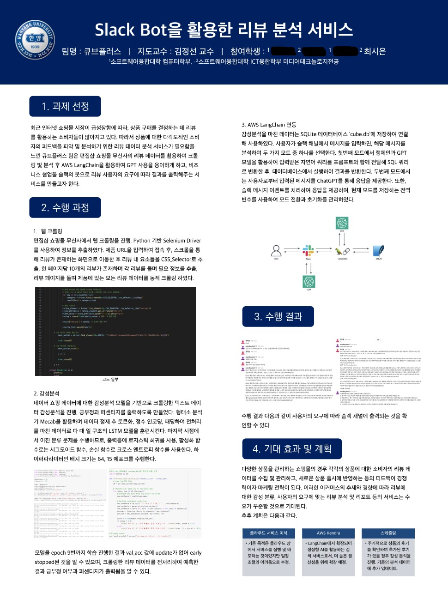

# 큐브플러스: Slack 봇 기반 상품 리뷰 감성분석 서비스

> 2023–2024 한양대학교 ERICA 산학 캡스톤디자인 (기업 멘토: 플러스제로) · 4인 팀 · 약 1년
>
> 무신사 상품 리뷰를 크롤링하고 감성분석한 뒤, 브랜드 담당자가 **Slack에서 자연어로 리뷰 반응을 조회**할 수 있게 만든 프로젝트입니다.



---

## 1. 문제 정의

온라인 패션 브랜드에게 리뷰는 소비자 반응을 확인하는 가장 직접적인 창구입니다. 하지만 상품이 많고 리뷰가 계속 쌓이면 **부정 리뷰만 골라 보거나 "사이즈·원단 불만이 몇 건인지" 파악하기가 어렵고**, 그래서 제품 리뉴얼에 반영되기까지 시간이 걸립니다.

**목표:** 리뷰 수집 → 감성분석 → 브랜드 담당자가 이미 쓰는 협업툴(Slack)에서 바로 조회

## 2. 실제 구현한 구조

```
[무신사 상품 URL]
      │  Selenium 동적 크롤링 (리뷰 텍스트, 사이즈, 별점, 작성일)
      ▼
[리뷰 CSV] ──► [GRU 감성분석 모델] ──► 긍정/부정 + 확률
      │
      ▼
[SQLite cube.db] ◄── LangChain + GPT (자연어 → SQL) ◄── [Slack 봇] ◄── 사용자
```

| 단계 | 구현 내용 | 코드 |
|---|---|---|
| 크롤링 | Selenium, CSS Selector로 리뷰 페이지 순회. 별점은 별 이미지 `width` 비율로 변환 | `crawler/` |
| 감성분석 | 네이버 쇼핑 리뷰 20만 건 학습, Mecab 토큰화, GRU 이진분류 | `sentiment/` |
| Slack 봇 | Socket Mode. 상품 URL 입력 시 크롤링 → CSV 저장 → 감성분석 실행 | `slack_bot/` |
| LLM 조회 | LangChain Text-to-SQL 모드 / 일반 GPT 대화 모드 전환 | ⚠️ 코드 미보존 (판넬 설명만 남음) |

## 3. 팀 구성과 역할

| 이름 | 역할 |
|---|---|
| 팀원 A | PM |
| 팀원 B | PL, Slack 챗봇 |
| 팀원 C | Program Engineer |
| **최시은** | **감성분석 모델링**, 문서화 |

## 4. 감성분석 (담당 파트)

### 1차 시도: 직접 크롤링한 데이터로 학습 → 실패 (`sentiment/experiments/`)

| 파일 | 시도한 것 | 배운 점 |
|---|---|---|
| `01_senti.py` | NLTK(영어 불용어·표제어) + TF-IDF + SVM | 영어용 전처리는 한국어에 맞지 않음 |
| `02`–`05` | Okt 형태소 분석 + TF-IDF + SVR(별점 회귀) / SVM / 로지스틱 회귀 | 별점으로 라벨을 만들었지만 데이터가 **수십 건**뿐이라 학습이 무의미 |
| `06`, `07` | 텍스트 정제, 키워드 규칙 기반 판단 | 규칙 기반은 표현이 조금만 달라도 놓침 |

**진단:** 문제는 모델이 아니라 **라벨이 있는 데이터의 양**이었다.

### 2차: 공개 데이터셋 + 레퍼런스 구현 적용 (`sentiment/gru_sentiment.py`)

- 데이터: [네이버 쇼핑 리뷰 약 20만 건](https://github.com/bab2min/corpus/tree/master/sentiment) (별점 4–5 → 긍정, 1–2 → 부정)
- 전처리: 한글 외 문자 제거 → Mecab 토큰화 → 불용어 제거 → 희귀 단어(빈도 1) 제외 → 길이 80 패딩
- 모델: Embedding(100) → GRU(128) → Dense(sigmoid), EarlyStopping + ModelCheckpoint
- 구현은 위키독스 「딥 러닝을 이용한 자연어 처리 입문」의 *네이버 쇼핑 리뷰 감성 분류하기* 예제를 **참고해 그대로 적용**하고, 크롤링 CSV를 입력받는 `sentiment_predict_from_csv()`를 추가해 파이프라인에 연결했습니다.

| Epoch | 1 | 2 | 3 | 4 | **5** | 6–9 |
|---|---|---|---|---|---|---|
| val_acc | 0.9125 | 0.9202 | 0.9245 | – | **0.9256** | 개선 없음 → 9에서 early stop |

학습 로그: [`docs/gru_training_log.pdf`](docs/gru_training_log.pdf)

## 5. 회고: 지금 다시 본다면

**계획과 실제의 차이**

| 계획 | 실제 |
|---|---|
| AWS S3 저장 + AWS Kendra 검색 + LLM 요약 | 로컬 SQLite + LangChain Text-to-SQL |
| 1시간 주기 자동 리포트 | URL을 입력하면 수동 실행 |
| 클라우드 배포 | 로컬 실행 (일정 문제로 축소) |

**Kendra는 이 문제에 맞지 않는 도구였다.** Kendra는 여러 사내 문서를 검색하는 엔터프라이즈 검색 서비스이고, 인덱스를 켜두는 시간만큼 과금됩니다. 반면 우리 데이터는 별점·사이즈·날짜 같은 **정형 필드 중심**이었고, 핵심 질문도 "부정 리뷰를 카테고리별 분포로 보여줘" 같은 **집계형**이었습니다. 결과적으로 일정 때문에 택한 Text-to-SQL이 문제에 더 맞는 구조였고, *도구를 먼저 정하고 문제를 끼워 맞추면 안 된다*는 것을 배웠습니다.

**감성분석의 한계**
- **도메인 차이:** 네이버 쇼핑 전체 리뷰로 학습해서 "사이즈가 크다"처럼 패션 특유의 표현에 약할 수 있음. 무신사 리뷰로는 정확도를 따로 검증하지 않음.
- **긍정/부정만 판단:** 원래 목표였던 *무엇(사이즈·원단·부자재)에 대한 불만인지*(속성 기반 감성분석)까지 가지 못함.

**코드 구조의 한계**
- `import` 시점에 데이터 다운로드와 **모델 재학습이 매번 실행됨** (학습/추론 미분리)
- 감성분석 결과가 Slack이 아니라 콘솔로 출력됨
- 크롤러 상태(드라이버, 결과 리스트)가 전역 변수라 동시 요청을 처리할 수 없음

**지금 다시 만든다면**
- 학습된 모델을 저장해 추론만 서빙하거나, LLM으로 속성별 불만을 직접 추출
- 집계는 SQL, "이런 불만 리뷰 찾아줘" 같은 의미 검색은 벡터 DB로 역할 분리
- 컨테이너로 패키징해 배포하고, 스케줄러로 주기 리포트 구현

> 이 회고를 바탕으로 진행 중인 후속 프로젝트: _(링크 추가 예정)_

## 6. 저장소 구조

```
├── crawler/musinsa_review_crawler.py   # 리뷰 + 별점 크롤러
├── sentiment/
│   ├── experiments/                    # 1차 시도 (01~07)
│   └── gru_sentiment.py                # 2차: GRU 감성분석 (원본 파일명 cap2.py)
├── slack_bot/slack_bot.py              # Slack 봇 (크롤링 → 감성분석 연동)
└── docs/                               # 판넬, 학습 로그
```

## 참고 사항

- **보관용 저장소입니다.** 2024년 당시 코드를 거의 그대로 보존했습니다. 공개를 위해 바꾼 것은 다음뿐입니다: 하드코딩된 API 키·토큰 제거(→ 환경변수), 로컬 경로 제거, 파일 인코딩 변환(cp949 → UTF-8), 파일명 정리, 팀원 개인정보 보호를 위한 이름 비공개 처리.
- 무신사 페이지 구조가 바뀌어 크롤러는 현재 동작하지 않을 수 있으며, `text-davinci-003` 등 당시 OpenAI API는 지원이 종료되었습니다.
- 크롤링한 리뷰 데이터는 작성자 ID가 포함되어 있고 사이트 이용약관 문제가 있어 포함하지 않았습니다.
